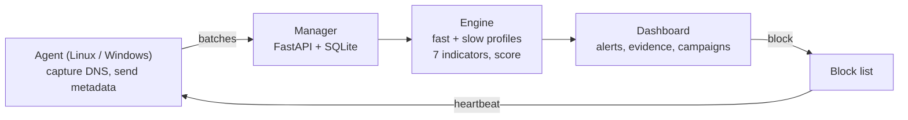

# DNSHollow

**A centralized, multi-signal DNS tunneling detection and blocking system for Linux and Windows.**

DNSHollow finds DNS tunneling (data theft and command-and-control hidden inside DNS names) by combining seven behaviour
indicators into one explainable score. Light agents on your computers send DNS metadata to one manager. The manager scores
it, shows evidence on a dashboard, and can block the bad domain on the affected machines, by one click or automatically.

---

## Why

DNS is allowed through almost every firewall and is rarely inspected. Tools like iodine and dnscat2 use that to hide traffic
in long random subdomains such as `x8f3k2q9...attacker.com`.

| Existing tool | Gap |
|---|---|
| Snort | Fixed signatures. New or custom tunneling tools are missed. |
| Wazuh | Only three conditions (encoding, depth, record type). Many tunnels are missed. |
| **DNSHollow** | Seven combined indicators, two time windows, cross-host correlation, one-click blocking. No machine learning, so every alert is explainable. |

## Features

- **Seven indicators, one score (0 to 100):** entropy, subdomain depth, record types, query frequency, beacon timing, unique subdomains, data volume.
- **Two profiles:** *fast* (last 5 minutes, every 30 s) for noisy tunnels, *slow* (last 24 hours, every 5 min) for stealth beacons.
- **Campaigns:** the same bad domain seen on two or more computers is grouped.
- **Linux and Windows agents** using only the Python standard library. Offline spool if the manager is down.
- **DNS blocking:** manual (from an alert or the Blocks page) or automatic above a score you choose. Reversible, with expiry.
- **Dashboard:** Overview, Alerts, Agents, Blocks, Logs, Settings, audit trail. Plain HTML, CSS and JS.
- **Security by default:** forced password change, hashed passwords and keys, one-time install tokens, login rate limit, sandboxed Linux service.

## How it works



**Agent:** captures DNS packets (port 53), pairs each query with its response, drops loopback, manager and trusted traffic,
and sends a batch every 10 seconds (name, type, time, sizes, resolver; never content). Every minute it fetches its settings
and block list.

**Manager:** authenticates the agent, stores the records, groups them by *host + registered domain*, measures the seven
indicators and writes alerts with the evidence behind them.

### Scoring

Each indicator becomes a strength from 0 to 1 using a linear ramp. Default fast-profile values:

| Indicator | Measures | Weight | 0 at | 1 at |
|---|---|---|---|---|
| Entropy | Randomness of subdomain text (bits) | 0.20 | 3.0 | 4.5 |
| Depth | Average number of subdomain labels | 0.10 | 2 | 4 |
| Record types | Share of TXT, NULL, CNAME, MX | 0.15 | 5% | 30% |
| Frequency | Queries per minute to the domain | 0.15 | 10 | 50 |
| Timing | Variation of the gaps (low = regular) | 0.15 | 0.5 | 0.1 |
| Unique subdomains | Number of different names | 0.15 | 20 | 200 |
| Data volume | Characters of unique subdomain text | 0.10 | 500 | 5000 |

```
score = 100 x sum(weight x strength)
```

An alert needs at least **2 strong indicators** (strength 0.5 or more) in the fast profile and 3 in the slow profile.
Severity: **Low** from 40, **Medium** from 60, **High** from 80. Weights, thresholds, windows and trusted domains
are all editable in **Settings**.

## Screenshots

| Sign in | Overview |
|---|---|
|  |  |

| Alerts | Alert details |
|---|---|
|  |  |


## Quick start

### 1. Manager (any Linux machine with Python 3.8+)

```bash
git clone https://github.com/HusnainZargar/DNSHollow.git
cd DNSHollow
bash run.sh                          # sets everything up and starts it
sudo bash run.sh --install-service   # optional: run 24/7 and start at boot
```

Options: `--host`, `--port 9000`, `--reset-password`.

On the first start the terminal prints a **temporary login** (user `admin`), also saved in `data/initial-credentials.txt`.
Open the dashboard and you will be asked to choose your own password.

> **Forgot your password?** On the manager machine run `sudo bash run.sh --reset-password`.

### 2. Add an agent

Open **Agents**, type a name, pick the **Linux** or **Windows** tab and copy the command. Use the manager's **LAN address**,
not `localhost`. The command works once and expires after 15 minutes.

| | Linux | Windows |
|---|---|---|
| Run as | `root` | Administrator PowerShell |
| Needs | Python 3.8+ | Python 3.8+ installed for all users (`winget install -e --id Python.Python.3.12 --scope machine`) |
| Runs as | systemd service, non-root user | Scheduled Task as SYSTEM, starts at boot |
| Capture | Raw `AF_PACKET` socket with a kernel filter | Raw IPv4 socket per local address (`SIO_RCVALL`) |
| Remove | same command with `--uninstall` | same command with `-Uninstall` |
| Logs | `journalctl -u dnshollow-agent` | `C:\ProgramData\DNSHollow\agent.log` |

Both installers verify the SHA-256 of the download, register with the one-time token and run a self-check before starting.

## Blocking DNS

| Where | What |
|---|---|
| Alert panel | **Block on this computer** or **Block on all computers** |
| **Blocks** page | Block any domain by hand for 1 h, 24 h, 7 d or until removed; unblock |
| **Settings > Blocking** | Master switch, **auto-block** on/off (off by default), score level (default 90), scope, duration (default 24 h) |

Agents installed with blocking enabled (ticked by default in the install command) make the computer drop DNS for the domain
**and all its subdomains**.

| OS | Method | Needs |
|---|---|---|
| Linux | Own iptables chain `DNSHOLLOW` linked from `OUTPUT`; drops port 53 packets that contain the domain name (IPv4 and IPv6) | `CAP_NET_ADMIN` (added by `--enable-blocking`), `iptables` |
| Windows | NRPT rules (comment `DNSHollow`) send the domain to a dead resolver (127.0.0.1) | Administrator or SYSTEM |

**Safety rules:** only registered domains can be blocked (never `com`, `co.uk` or an IP address); trusted domains and the
manager's own address are never blocked; auto-block acts only on alerts nobody has reviewed; *Not a threat*, *Trust this domain*
and *Unblock* lift blocks; timed blocks expire by themselves. Emergency removal on a computer:
`python -m dnshollow_agent --unblock-all`.

## Testing with fake traffic

`tools/fake_dns_traffic.py` sends made-up DNS queries (reserved `.test` names) at different danger levels, so you can test
alerts, campaigns and auto-block without a real attack.

```bash
python3 tools/fake_dns_traffic.py all --server http://127.0.0.1:8000 --admin-key "$(cat data/admin.key)"
python3 tools/fake_dns_traffic.py high --server http://127.0.0.1:8000 --admin-key "$(cat data/admin.key)" --loop 120
```

| Level | Imitates | Expected |
|---|---|---|
| `benign` | Normal browsing | No alert |
| `low` | Busy hash-named CDN | Low (about 47) |
| `medium` | TXT-heavy, fairly regular | Medium (about 69) |
| `high` | iodine / dnscat2 style | High (about 85) |
| `critical` | Everything wrong at once | High, 100 (passes the default auto-block level) |
| `slow` | Stealth beacon, one query per ~22 min | Slow profile alert |
| `campaign` | One bad domain on three computers | High alerts and a campaign |

Fake agents cannot enforce blocks. For a real blocking test, install a real agent and block a domain you own.
On Windows check with `Resolve-DnsName` or the browser, not `nslookup` (it skips the Windows resolver policy).

## Tests

```bash
pip install -r requirements-dev.txt
python3 -m pytest -q            # 243 tests; the real-capture tests need root (raw sockets)
bash tests/ui/run.sh            # optional: drives the dashboard in a simulated browser (needs node)
```

## Project layout

```
agent/dnshollow_agent/   agent for Linux and Windows (standard library only)
  capture.py, capture_win.py   packet capture      blocker.py   DNS blocking
  dnsparse.py, pairing.py      DNS decoding        spool.py     offline buffer
manager/api/             REST API (docs at /docs)
manager/engine/          features, scorer, runner, blocking rules
manager/dashboard/       web dashboard (plain HTML, CSS, JS)
manager/dist/            installers served to agents (install-linux.sh, install-windows.ps1)
tools/                   fake DNS traffic generator
tests/                   automated tests
run.sh                   one-command setup and start
```

## Limitations

- Thresholds were tuned and tested on **synthetic traffic**. Tune on real traffic before relying on auto-block.
- The Windows agent sees **IPv4** DNS only. DNS over HTTPS and TLS are not visible to either agent.
- The Windows block affects software that uses the Windows resolver. Group Policy resolver rules override local ones.
- One administrator account. The manager serves plain HTTP: put it behind HTTPS (for example a reverse proxy) outside a lab.
- Email security (SPF, DKIM, DMARC checks) is not implemented yet.

## Roadmap

Multi-user roles and MFA, built-in HTTPS, DNS over HTTPS detection, IPv6 capture on Windows, SPF/DKIM/DMARC and DNSSEC checks,
syslog export of alerts.

## Responsible use

Use DNSHollow only on networks and computers you own or are allowed to monitor. Blocking can interrupt real services, so keep
auto-block off until you have tuned the settings.

## Author

**Muhammad Husnain Zargar**, BS Cybersecurity, Riphah International University.
